# Praktikum Minggu 02
LAPORAN PRAKTIKUM MODUL 2
SISTEM TERDISTRIBUSI DAN TERDESENTRALISASI
Pengelolaan Proses dan Implementasi GraphQL Server Menggunakan Strawberry

# A. Tujuan Pembelajaran
1. Memahami cara memantau dan mengelola proses aplikasi yang berjalan pada sistem operasi Windows.
2. Mengetahui cara menghentikan dan menjalankan kembali proses aplikasi melalui fasilitas sistem operasi.
3. Memahami penerapan komunikasi client-server dengan menggunakan teknologi GraphQL.
4. Mempelajari penggunaan Python dan Strawberry untuk membangun layanan GraphQL yang dapat menyediakan data kepada client.
5. Mempraktikkan pengiriman query dari client serta mengamati respons yang diberikan oleh server.

# B. Dasar Teori
1. Proses pada Sistem Operasi
Proses merupakan program yang sedang dijalankan oleh sistem operasi. Setiap proses mempunyai identitas berupa Process ID (PID) yang dapat digunakan untuk membedakan satu proses dengan proses lainnya. Dalam sistem operasi Windows, informasi proses dapat diamati melalui Task Manager maupun PowerShell.
Pengelolaan proses diperlukan untuk mengetahui aplikasi yang sedang aktif, menghentikan aplikasi yang tidak diperlukan, dan menjalankan kembali aplikasi apabila dibutuhkan. Penghentian proses secara paksa perlu dilakukan dengan hati-hati karena dapat menyebabkan data yang belum disimpan hilang.

2. Sistem Terdistribusi
Sistem terdistribusi merupakan sistem yang melibatkan beberapa komponen komputer atau perangkat lunak yang berkomunikasi untuk menjalankan suatu layanan. Salah satu pola komunikasi yang umum digunakan adalah client-server.
Client bertugas mengirimkan permintaan kepada server, sedangkan server memproses permintaan tersebut dan mengembalikan hasilnya. Melalui pola ini, client dapat memanfaatkan layanan yang disediakan server tanpa harus menjalankan seluruh proses pengolahan data secara mandiri.

3. GraphQL
GraphQL adalah teknologi untuk meminta dan menyediakan data melalui sebuah antarmuka yang terstruktur. Client dapat menentukan field yang dibutuhkan sehingga respons yang diterima berisi data sesuai dengan permintaan tersebut.
Pada praktikum ini, query GraphQL digunakan untuk mengambil informasi buku berupa title dan author. Server menyediakan data tersebut melalui schema yang mendefinisikan struktur data dan operasi yang dapat dijalankan.

4. Python dan Strawberry
Python merupakan bahasa pemrograman yang digunakan untuk mengimplementasikan server dan client pada praktikum ini. Strawberry adalah pustaka Python yang digunakan untuk membangun schema GraphQL.
Dalam implementasinya, schema mendefinisikan tipe data dan operasi yang tersedia. Server menggunakan schema tersebut untuk memahami permintaan client dan menghasilkan respons yang sesuai.

# C. Langkah-Langkah Praktikum
## Praktikum 1: Mengelola Proses Aplikasi di Windows

### Langkah 1 — Membuka aplikasi untuk pengujian
Jalankan aplikasi Notepad melalui menu Start Windows. Aplikasi ini digunakan sebagai contoh proses yang akan diamati dan dikelola.

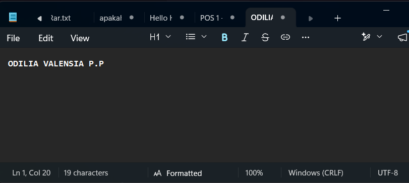

Penjelasan:
Notepad dipilih karena merupakan aplikasi sederhana yang dapat dijalankan kembali dengan mudah. Dengan menggunakan aplikasi ini, pengamatan proses dapat dilakukan tanpa perlu menghentikan proses sistem yang penting.

### Langkah 2 — Mengamati proses melalui Task Manager
Tekan Ctrl + Shift + Esc untuk membuka Task Manager.
Pilih bagian Details atau Processes, sesuai tampilan Windows.
Cari proses Notepad.
Amati nama proses dan informasi yang ditampilkan.

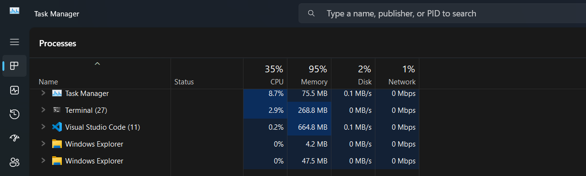

Penjelasan:
Task Manager menyediakan informasi mengenai aplikasi dan proses yang sedang berjalan. Melalui fasilitas ini, pengguna dapat mengetahui apakah aplikasi yang dibuka telah berjalan sebagai sebuah proses di sistem operasi.

### Langkah 3 — Memeriksa proses melalui PowerShell
Buka PowerShell, kemudian jalankan perintah berikut:
Get-Process notepad

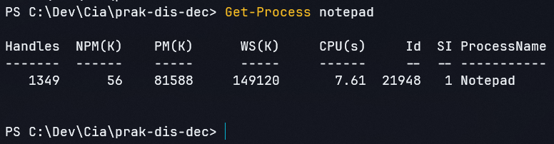

Penjelasan:
Perintah Get-Process digunakan untuk memperoleh informasi tentang proses yang sedang aktif. Parameter notepad membatasi pencarian pada proses dengan nama tersebut sehingga informasi aplikasi lebih mudah diamati. Apabila Notepad sedang berjalan, PowerShell akan menampilkan informasi proses yang ditemukan, termasuk PID.

### Langkah 4 — Menghentikan proses aplikasi
Jalankan perintah berikut di PowerShell:
Stop-Process -Name notepad -Force

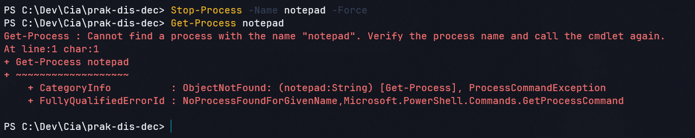

Penjelasan:
Perintah Stop-Process digunakan untuk menghentikan proses yang sedang berjalan. Parameter -Name notepad menentukan proses yang menjadi sasaran, sedangkan -Force meminta penghentian secara paksa. Pada pengujian ini, perintah digunakan untuk mengetahui bagaimana sistem operasi menangani proses yang dihentikan melalui PowerShell tanpa menggunakan menu Exit aplikasi.

### Langkah 5 — Menjalankan kembali aplikasi
Setelah proses sebelumnya dihentikan, jalankan perintah berikut:
Start-Process notepad

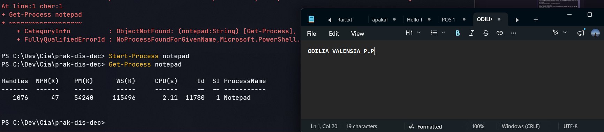

Penjelasan:
Perintah Start-Process digunakan untuk membuka aplikasi melalui PowerShell. Setelah perintah dijalankan, Notepad akan dibuka kembali dan sistem operasi akan membuat proses baru untuk menjalankannya. Langkah ini memperlihatkan bahwa proses aplikasi dapat dihentikan dan dijalankan kembali melalui fasilitas sistem operasi.

## Praktikum 2: Menggunakan Strawberry untuk GraphQL Server

### Langkah 1 — Memahami penggunaan uv
Pelajari petunjuk penggunaan uv yang dirujuk oleh modul praktikum:
Catatan penggunaan uv di GitHub
Buka PowerShell dan periksa apakah uv telah tersedia:
uv --version

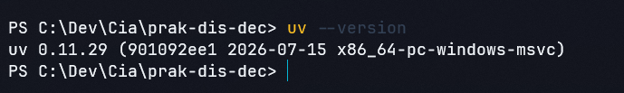

Penjelasan:
uv digunakan untuk membantu pengelolaan lingkungan dan paket Python. Sebelum melanjutkan, pastikan perintah tersebut dapat dijalankan. Jika belum tersedia, ikuti petunjuk instalasi pada referensi yang diberikan dalam modul.

### Langkah 2 — Membuat workspace
Masuk ke folder praktikum Modul 2. 
Buat workspace bernama workspace-01:
uv init workspace-01
Masuk ke workspace:
cd workspace-01

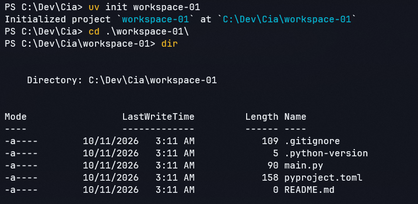

Penjelasan:
Workspace digunakan sebagai tempat menyimpan berkas program dan konfigurasi yang diperlukan selama praktikum. Pemisahan pekerjaan dalam satu direktori memudahkan pengelolaan kode serta lingkungan Python yang digunakan.

### Langkah 3 — Menggunakan Python versi 3.13
Jalankan perintah berikut:
uv python install 3.13

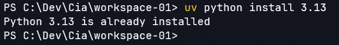

Selanjutnya, buat virtual environment:
uv venv --python 3.13

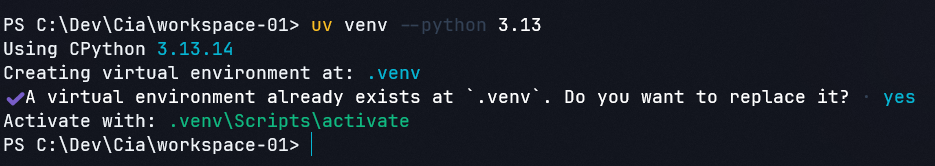

Aktifkan virtual environment di Windows:
.\.venv\Scripts\Activate.ps1
Periksa versi Python:
python --version

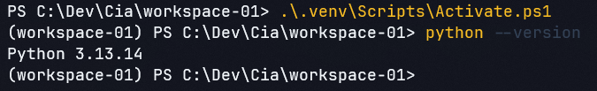

Penjelasan:
Virtual environment membantu memisahkan paket yang digunakan dalam praktikum dari paket Python pada lingkungan lain.
Aktivasi lingkungan memungkinkan perintah Python dijalankan menggunakan interpreter dari virtual environment tersebut.

### Langkah 4 — Memasang paket Strawberry GraphQL
Jalankan perintah instalasi sesuai modul:
uv pip install 'strawberry-graphql[cli]'
Setelah instalasi selesai, periksa paket yang terpasang:
uv pip show strawberry-graphql

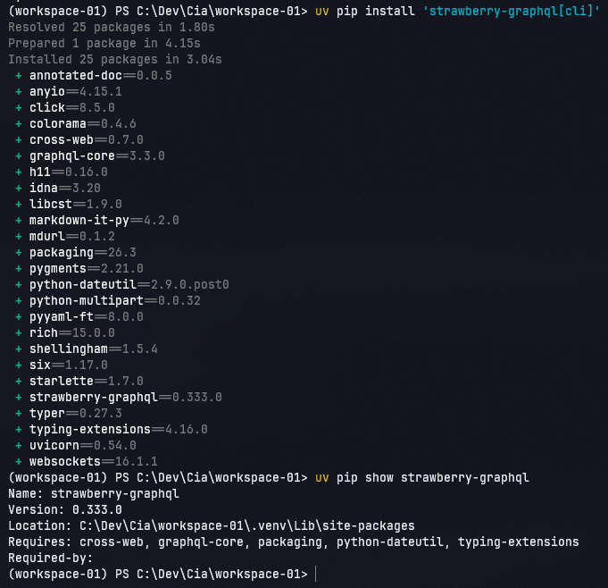

Penjelasan:
Paket strawberry-graphql[cli] menyediakan pustaka Strawberry beserta komponen tambahan untuk penggunaan antarmuka perintah. Paket ini diperlukan untuk mengimplementasikan schema GraphQL dan menjalankan server melalui CLI yang disediakan.

### Langkah 5 — Membuat file schema.py
Buat file bernama schema.py di dalam folder workspace-01. dengan isi ini

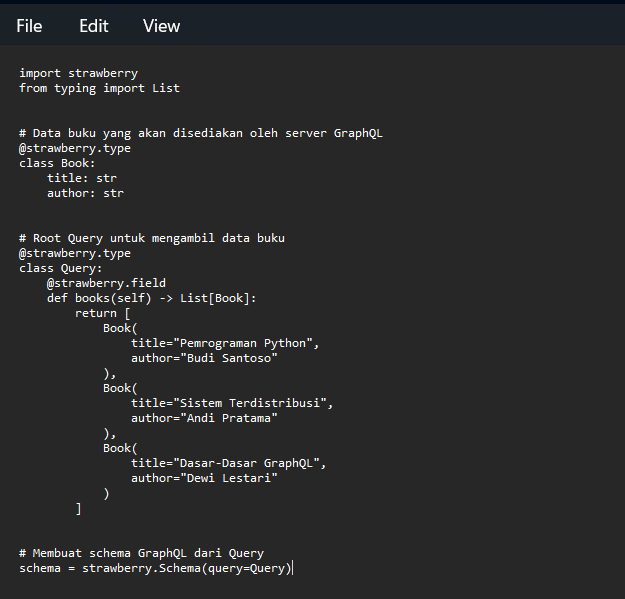

Penjelasan:
File schema.py berisi definisi tipe data buku dan operasi query yang dapat digunakan client. Class Book menentukan informasi yang tersedia, yaitu judul dan penulis. Sementara itu, class Query menyediakan field books untuk mengembalikan kumpulan data buku. Objek schema kemudian dibuat berdasarkan class Query agar definisi tersebut dapat digunakan oleh server GraphQL.

### Langkah 6 — Menjalankan GraphQL Server
Pastikan terminal berada di direktori yang berisi schema.py. Jalankan:
strawberry dev schema

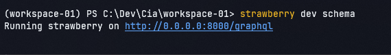

Penjelasan:
Perintah tersebut digunakan untuk menjalankan server melalui CLI Strawberry dengan modul schema. Jika berhasil, terminal akan menampilkan informasi mengenai server yang berjalan. Perintah ini mengasumsikan bahwa file schema.py menyediakan objek schema yang dapat ditemukan oleh CLI. 

### Langkah 7 — Memeriksa layanan GraphQL
Perhatikan alamat yang ditampilkan pada terminal. Jika server berjalan pada alamat lokal http://127.0.0.1:8000, coba buka endpoint berikut melalui browser:
http://127.0.0.1:8000/graphql

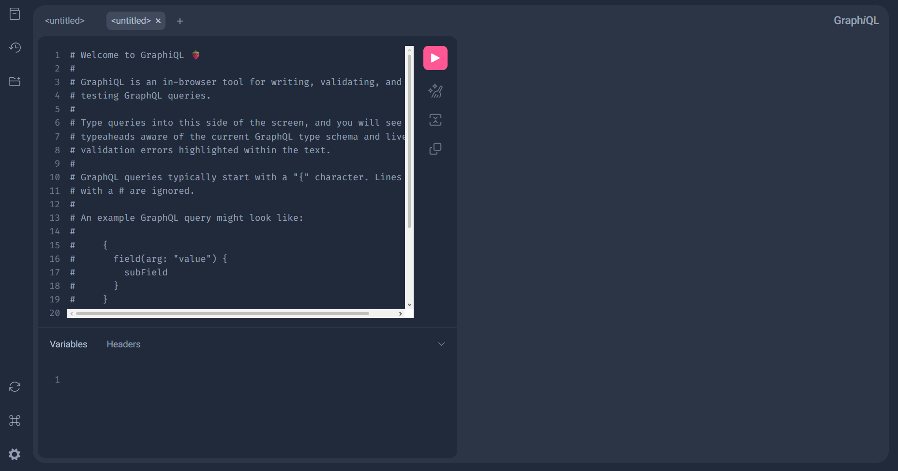

Penjelasan:
Endpoint GraphQL merupakan alamat yang digunakan client untuk mengirimkan permintaan kepada server. Dengan memeriksa endpoint, pengguna dapat melanjutkan pengujian query sesuai antarmuka dan konfigurasi server yang berjalan.

## Praktikum 3: Membuat Client untuk GraphQL Server
### Langkah 1 — Memahami query pengambilan data buku
query {
  books {
    title
    author
  }
}

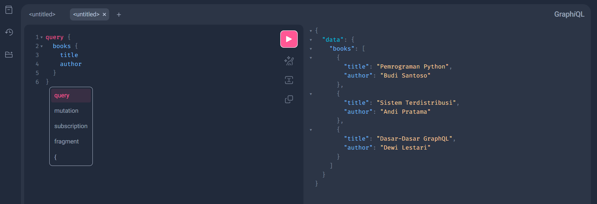

Penjelasan:
Query tersebut meminta data dari field books. Untuk setiap buku yang dikembalikan, client hanya meminta dua informasi, yaitu title dan author. GraphQL memungkinkan client menentukan field yang ingin diterima sehingga permintaan data dapat disesuaikan dengan kebutuhan aplikasi.

### Langkah 2 — Membuat aplikasi client
Buat file bernama client.py di dalam folder workspace-01, kemudian masukkan kode berikut:

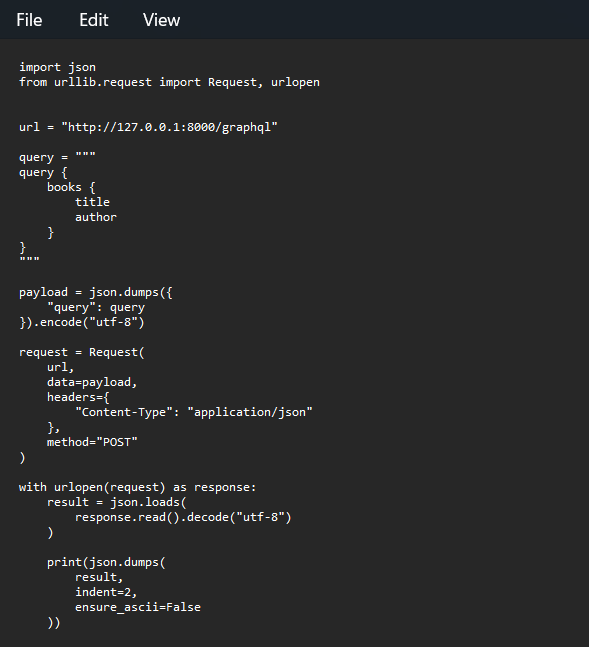

Penjelasan:
Program client menggunakan pustaka bawaan Python untuk mengirimkan permintaan HTTP kepada server GraphQL.
Query disimpan dalam variabel query, kemudian dimasukkan ke dalam payload JSON. Permintaan dikirim menggunakan metode POST dengan header Content-Type: application/json. Setelah menerima respons, program mengubah data JSON menjadi objek Python dan menampilkannya dalam format yang lebih mudah dibaca.
Kode ini menggunakan endpoint contoh http://127.0.0.1:8000/graphql. 

### Langkah 3 — Menjalankan aplikasi client
Biarkan server tetap berjalan pada terminal pertama. Buka terminal PowerShell kedua, masuk ke folder workspace-01, lalu
Jalankan aplikasi client:
python client.py

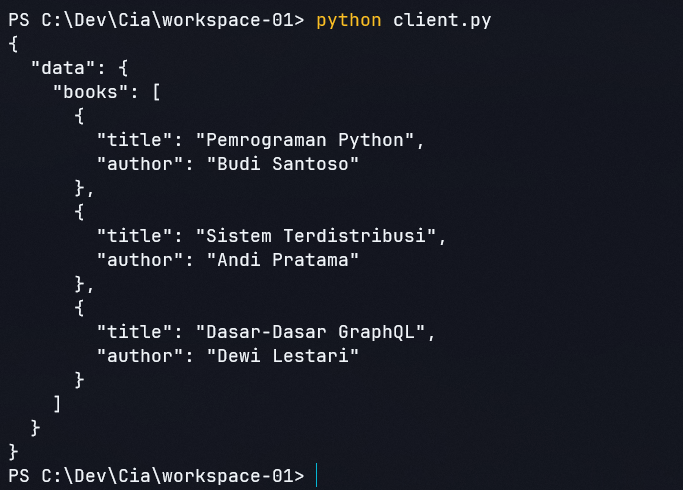

Penjelasan:
Server harus tetap aktif agar dapat menerima permintaan yang dikirim oleh client. Ketika client.py dijalankan, program mengirimkan query buku ke endpoint GraphQL dan menunggu respons dari server. Jika koneksi berhasil dan query sesuai dengan schema, hasil respons akan ditampilkan pada terminal client.
Respons menunjukkan bahwa server mengembalikan data berdasarkan query yang dikirim client. Informasi yang diterima mencakup judul dan penulis setiap buku karena kedua field tersebut dicantumkan dalam query.

# D. Kesimpulan

Praktikum Modul 2 memberikan pemahaman mengenai pengelolaan proses aplikasi pada Windows dan penerapan komunikasi client-server menggunakan GraphQL. Melalui Task Manager dan PowerShell, proses aplikasi dapat diamati, dihentikan, serta dijalankan kembali sesuai kebutuhan.
Pada bagian GraphQL, Python dan Strawberry digunakan untuk mendefinisikan schema yang menyediakan data kepada client. Client kemudian mengirimkan query untuk meminta informasi tertentu dan menerima respons dari server. Dengan demikian, praktikum ini membantu memahami hubungan antara pengelolaan proses, penyediaan layanan, serta pertukaran data dalam implementasi sistem terdistribusi.